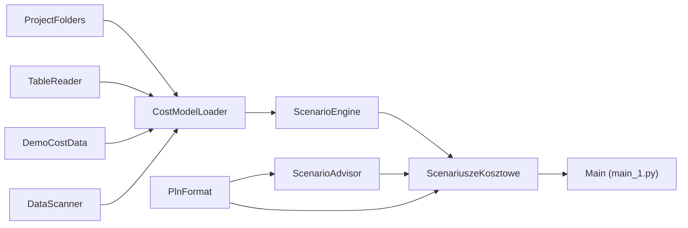

# Scenariusze kosztowe — co się stanie, jeśli zdrożeją surowce?

Interaktywny symulator **„co, jeśli?”** dla firmy produkcyjnej. Program wczytuje produkty, receptury
(BOM), ceny surowców i koszty stałe, buduje z nich model kosztowy i pokazuje, jak zmiana ceny
wybranego surowca wpływa na **EBITDA**, marżę, próg rentowności i marże poszczególnych produktów —
oraz o ile trzeba podnieść ceny, żeby utrzymać zarobek.

Przykładowa firma to **fikcyjny producent stolarki aluminiowej i PVC** (okna, drzwi, fasady, bramy,
balustrady, rolety, parapety) z marżą EBITDA ok. 9%, w której najtańsze wyroby aluminiowe mają cienką
marżę łatwo zjadaną przez wzrost ceny aluminium.

Projekt jest zbudowany w CatNip — wizualnym edytorze Pythona opartym na blokach. Każdy blok to jedna
klasa w osobnym pliku `.py` z własną stroną dokumentacji `.md`.

> [!WARNING]
> **To jest projekt poglądowy (demonstracyjny), a nie porada inwestycyjna ani biznesowa.**
> Dane demonstracyjne są **fikcyjne** — produkty, ceny, wolumeny i koszty zostały wymyślone, a nazwy
> dostawców służą wyłącznie ilustracji i nie odzwierciedlają ich rzeczywistych cen ani warunków.
> Model jest uproszczony (stałe koszty stałe, liniowy wpływ cen surowców, brak efektów zapasów,
> kursów walut i podatków). Wyniki nie mogą być podstawą decyzji cenowych, zakupowych, inwestycyjnych
> ani finansowych. Autor nie ponosi odpowiedzialności za decyzje podjęte na podstawie wyników programu.

## Co pokazuje strona

- **Kontrolki**: wybór surowca, zmiana jego ceny, przerzucenie wzrostu kosztu na ceny sprzedaży,
  zmiana wolumenu.
- **KPI**: EBITDA, marża EBITDA, próg rentowności (przychód) i liczba zagrożonych produktów — ze zmianą
  względem scenariusza bazowego.
- **Odpowiedź w kilku zdaniach**: zmiana EBITDA, produkty zagrożone, potrzebne podwyżki cen, przy jakim
  wzroście surowca EBITDA spada do zera.
- **Drabina scenariuszy** BASE → +10% → +15% → +25%.
- **Wrażliwość**: zmiana EBITDA przy +10% ceny każdego surowca — który boli najbardziej.
- **Marże produktów** przed i po zmianie, ze statusem `OK` / `zagrożony` (marża < 5%) / `strata`.
- **Struktura kosztów** i **Data Scan** — rozpoznane pliki, kolumny, klucze i czas kroków.

## Jak liczy

- Koszt jednostkowy produktu = Σ (zużycie surowca z BOM × cena surowca × (1 + zmiana ceny)) + robocizna.
- Cena sprzedaży rośnie o *przerzucenie na ceny* % wzrostu kosztu jednostkowego.
- Wolumen zmienia się o *zmianę wolumenu* %.
- Koszty stałe pozostają bez zmian; EBITDA = marża pokrycia − koszty stałe.

## Kontrolki

| Kontrolka | Zakres | Znaczenie |
|---|---|---|
| Surowiec | lista | Aluminium, szkło zespolone, stal, profil PVC, energia elektryczna, okucia, opakowanie. |
| Zmiana ceny surowca | −20…+60% (krok 1) | Szok cenowy wybranego surowca. |
| Przerzucenie na ceny | 0–100% (krok 5) | Jaka część wzrostu kosztu trafia do cen sprzedaży. |
| Zmiana wolumenu | −30…+20% (krok 1) | Zmiana sprzedaży wszystkich produktów. |

## Dane wejściowe

Program czyta cztery pliki z folderu `input/` — każdy w innym formacie, a Data Scan sam rozpoznaje
ich kolumny, klucze i powiązania:

| Plik | Zawartość |
|---|---|
| `products.xlsx` | Produkty: cena, wolumen roczny, robocizna na sztukę. |
| `bom.csv` | Receptury: zużycie surowca na sztukę produktu. |
| `resources.json` | Surowce i energia: jednostka, cena, dostawca. |
| `overheads.json` | Roczne koszty stałe. |

Gdy któregoś pliku brakuje, blok `DemoCostData` tworzy dane demonstracyjne przy pierwszym uruchomieniu.
Pliki **nie są przechowywane w repozytorium** — na każdej maszynie powstają same, zawsze takie same.

**Własne dane:** umieść w `input/` własne pliki o tych samych kolumnach — program użyje ich zamiast
danych demonstracyjnych. `CostModelLoader` sprawdza, czy każda pozycja BOM wskazuje znany produkt
i surowiec. Folder `input/` jest wykluczony z gita, więc dane firmy nie trafią przypadkiem do repozytorium.

## Wymagania

- **Python 3.9 lub nowszy**.
- Pakiety z [`requirements.txt`](requirements.txt): `pandas`, `numpy`, `matplotlib`, `openpyxl`.
- **CatNip** — do wyświetlenia interaktywnej strony.

Internet nie jest potrzebny.

## Instalacja

```bash
git clone <adres-repozytorium>
cd ScenariuszeKosztowe

python -m venv .venv
# Windows:
.venv\Scripts\activate
# Linux / macOS:
source .venv/bin/activate

pip install -r requirements.txt
```

## Uruchomienie

### W CatNip (zalecane)

1. Otwórz `ScenariuszeKosztowe.catnip` w CatNip.
2. Wybierz środowisko Pythona z zainstalowanymi pakietami (venv albo Docker).
3. Uruchom przepływ (Run). Strona pojawi się w zakładce **Output** i przelicza się po każdej zmianie
   kontrolki.

### Bez CatNip

```bash
python main_1.py
```

Dane się wygenerują i model policzy się w całości, ale interaktywną stronę wyświetla tylko Run Engine
CatNip — poza nim zostanie wypisany jedynie komunikat, że strony nie ma gdzie pokazać.

## Struktura projektu



### Bloki, które wykonują pracę

| Blok | Do czego służy |
|---|---|
| `ProjectFolders` | Folder projektu (z plikiem `.catnip`) oraz `input/` i `output/`; działa lokalnie i w Dockerze. |
| `TableReader` | Czyta CSV, JSON i Excel do `pandas.DataFrame`. |
| `DataScanner` | Data Scan: typy kolumn, braki, klucze tabel i powiązania między plikami. |
| `DemoCostData` | Tworzy dane demonstracyjne w `input/`, gdy ich brak. |
| `CostModelLoader` | Wczytuje cztery pliki, robi Data Scan, sprawdza spójność BOM i buduje `CostModel`. |
| `ScenarioEngine` | Silnik scenariuszy: wynik dowolnego scenariusza, drabina, wrażliwość, szok do zerowej EBITDA, struktura kosztów. |
| `PlnFormat` | Liczby i kwoty po polsku (spacja tysięcy, przecinek, zł / tys. zł / mln zł). |
| `ScenarioAdvisor` | Zamienia wynik scenariusza w kilka zdań odpowiedzi. |
| `ScenariuszeKosztowe` | Interaktywna strona raportu. |
| `Main` | Punkt wejścia; z niego CatNip generuje `main_1.py`. |

### Rekordy danych (`@dataclass`)

| Blok | Co przechowuje |
|---|---|
| `ColumnProfile`, `TableProfile` | Profil kolumny i pliku źródłowego z Data Scan. |
| `PipelineStep`, `DataScan` | Krok przetwarzania z czasem oraz cały wynik Data Scan. |
| `CostModel` | Model kosztowy firmy: produkty, BOM, surowce, koszty stałe. |
| `Scenario` | Założenia scenariusza: zmiany cen surowców, przerzucenie na ceny, zmiana wolumenu. |
| `ProductResult` | Wynik jednego produktu: marża przed i po, potrzebna podwyżka ceny, status. |
| `ScenarioResult` | Wynik firmy: EBITDA, marża EBITDA, próg rentowności, produkty zagrożone. |

Każdy blok ma swoją szczegółową dokumentację w pliku `<NazwaBloku>.md`.

### Pliki i foldery

| Ścieżka | Opis | W repozytorium |
|---|---|---|
| `ScenariuszeKosztowe.catnip` | Projekt CatNip (graf bloków). | tak |
| `*.py`, `*.md` | Kod i dokumentacja bloków; `main_1.py` — wygenerowany punkt wejścia. | tak |
| `requirements.txt` | Zależności Pythona. | tak |
| `input/` | Dane wejściowe — demonstracyjne (generowane) albo własne. | nie |
| `output/` | Folder na wyniki. | nie |

## Licencja

Licencja nie została jeszcze wybrana — do czasu dodania pliku `LICENSE` wszystkie prawa zastrzeżone.

## Zastrzeżenie

Projekt ma charakter wyłącznie **poglądowy i edukacyjny**. Dane są fikcyjne, a model jest
uproszczeniem. Nie stanowi porady inwestycyjnej, finansowej ani biznesowej. Wszelkie decyzje
podejmujesz na własną odpowiedzialność.
